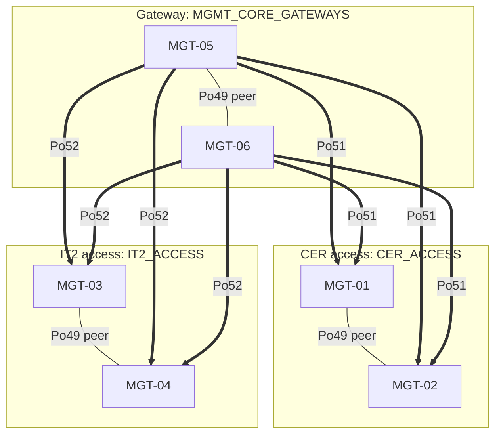

# Arista six-switch, three-domain MLAG automation

I built this example to model a redundant Arista management network using **three MLAG pairs** and cross-pair LACP links. It uses YAML source-of-truth, Python configuration rendering and Ansible staged deployments. It is separate from my Arista EVPN-VXLAN fabric and the Cisco Nexus EVPN submodule.

## Network architecture



**Design rules:** Each pair has its *own* Po49/VLAN4094 peer-link and unique /31 peer IPs. Only gateway switches MGT-05/06 advertise the VARP gateways. On each pair, the MLAG member Port-Channels have consistent IDs and VLAN lists. The links joining distinct domains are LACP trunks—not MLAG control links.

## 10 automated scenarios

| ID | Operation | Executable file |
|---|---|---|
| 01 | Validate the YAML design, VLANs, IPs, pair membership and port reuse | `python/validate.py` |
| 02 | Render 24 phase-specific EOS configuration files | `python/render.py` |
| 03 | Back up all six EOS devices | `ansible/03_backup.yml` |
| 04 | Capture live link/STP/CLI preflight | `ansible/04_preflight.yml` |
| 05 | Configure Po49/VLAN4094 LACP peer-links | `ansible/05_peerlink.yml` |
| 06 | Configure MLAG domain and peer IPs | `ansible/06_mlag.yml` |
| 07 | Configure Po51/Po52 inter-pair LACP and Po47/Po48 firewall-facing LACP | `ansible/07_bundles.yml` |
| 08 | Configure SVIs, VARP and management addressing | `ansible/08_gateway.yml` |
| 09 | Verify MLAG/LACP/STP/interface operational state | `ansible/09_verify.yml` |
| 10 | Generate a unified diff against approved captured configuration | `python/drift.py` |

[Detailed runbook](docs/runbook.md) · [Topology diagram source](docs/topology.mmd) · [YAML fabric data](data/fabric.yml)

## First run

```bash
cd arista-fabric/mlag-six-switch
python3 -m venv .venv
. .venv/bin/activate
pip install -r requirements.txt
python python/validate.py
python python/render.py
pytest -q tests

cd ansible
ansible-galaxy collection install -r requirements.yml
export EOS_USERNAME=admin EOS_PASSWORD='your-lab-secret'
ansible-playbook 03_backup.yml
ansible-playbook 04_preflight.yml
ansible-playbook 05_peerlink.yml -e approved=true -e expected_change_id=LAB-123 --check --diff --limit MGT-01,MGT-02
```

Default inventory uses **documentation-only 192.0.2.0/24 addresses**, so update `ansible/inventory/hosts.yml` to your isolated Containerlab management IPs. The companion six-switch topology is in [Containerlab](../../containerlab/examples/arista-cer-mlag/topology.clab.yml). The Python generator creates output under `output/`, which is excluded from Git. Review the rendered changes, run one MLAG pair at a time, and validate each before enabling inter-pair links.

**Important:** I have not tested these against live EOS hardware. No claim of battle-tested production safety is implied; `--check` and `--diff` are preliminary safeguards, not proofs of safe link migration. The stage scripts never save startup-config automatically. Do not use this as a production migration plan without OOB access, approved cabling, firewall verification and rollback procedure.

## Official references
- [Arista MLAG](https://www.arista.com/en/um-eos/eos-multi-chassis-link-aggregation)
- [Ansible eos_config](https://docs.ansible.com/projects/ansible/latest/collections/arista/eos/eos_config_module.html)
